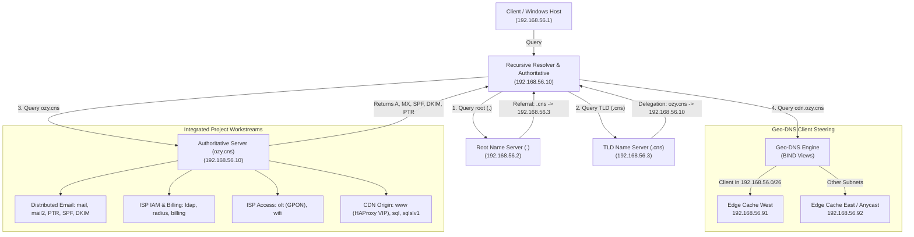

# PBL DNS & CDN Infrastructure: Complete DNS Tree & Geo-DNS

[](https://www.debian.org/)
[](https://www.isc.org/bind/)
[]()

> **Student / Technical Lead:** Okwudili Ujubuonu (Dili)  
> **Course:** Computer Networks & Internetworking (CNS3204)  
> **Project Scope:** Complete DNS Tree + Distributed Email + ISP Network + CDN Elective

---

## ⚡ TL;DR (Executive Summary)

* **What was built?** A production-grade **hierarchical DNS Tree** (`.` Root &rarr; `.cns` TLD &rarr; `ozy.cns` Authoritative &rarr; `cdn.ozy.cns` Geo-DNS) running on Debian BIND 9 using VirtualBox Host-Only subnet `192.168.56.0/24`.
* **Deliverables Implemented & Verified:**
  1. **Complete DNS Tree (Root & TLD):** Root (`192.168.56.2`) delegates `.cns` to TLD (`192.168.56.3`), which delegates `ozy.cns` to the Authoritative server (`192.168.56.10`).
  2. **Distributed Email System (Roy):** Forward DNS, dual MX (`mail` & `mail2`), **PTR Reverse DNS** in `56.168.192.in-addr.arpa`, and anti-spam authentication (**SPF** `v=spf1` and **DKIM** `v=DKIM1`).
  3. **Complete ISP Network (Austin & Joe):** Centralized naming for IAM (`ldap`, `radius`), Billing (`billing.ozy.cns`), GPON core (`olt.ozy.cns`), and WiFi (`wifi.ozy.cns`).
  4. **Content Delivery Network Elective (Joy Kioko & Joy Ndira):** **Geo-DNS using BIND 9 split-horizon views** routing clients dynamically to their nearest edge cache (`192.168.56.91` for Region West, `192.168.56.92` for Region East / Anycast) with a 60-second TTL.

---

## 📐 DNS Hierarchy & Topology



---

## 🧠 Why Have We Chosen to Structure It This Way?

1. **RFC-Compliant Iterative Tree (RFC 1034 / 1035):**
   - Real-world networks do not use a single monolithic DNS server. By structuring distinct Root (`.`), TLD (`.cns`), and Authoritative (`ozy.cns`) tiers, we demonstrate iterative referrals and NS delegation chains.
   - Authoritative views operate with `recursion no;` to isolate attack vectors, prevent DNS amplification DDoS attacks, and stop cache poisoning.
2. **Forward-Confirmed Reverse DNS (FCrDNS) & Email Deliverability:**
   - Mail servers reject emails whose sending IP does not match its reverse `PTR` record. Delegating `56.168.192.in-addr.arpa` gives `192.168.56.20` &rarr; `mail.ozy.cns.`, satisfying standard spam filtering policies alongside SPF and DKIM.
3. **Split-Horizon Geo-DNS for the CDN Elective:**
   - Clients resolve `edge.cdn.ozy.cns` to the geographically nearest cache (West vs East) without backhauling requests to the origin.
   - Low TTL (60s) ensures traffic can reroute instantly if an edge node fails.
4. **Shielding Backend Clusters:**
   - The origin web load balancer (`www.ozy.cns` HAProxy) and MariaDB cluster (`sql`, `sqlslv1`, `sqlslv2`) remain private and internal. End users only interact with the edge CDN layer.

---

## 📋 Master IP & Resource Allocation

| Role / Level | Domain / Hostname | IP Address | Purpose |
| :--- | :--- | :--- | :--- |
| **Root DNS (`.`)** | `root.server` | `192.168.56.2` | Emulates Global Root; delegates `.cns` |
| **TLD DNS (`.cns`)**| `tld.cns` | `192.168.56.3` | Emulates TLD Registry; delegates `ozy.cns` |
| **Authoritative NS** | `ns1.ozy.cns` | `192.168.56.10` | Authoritative for `ozy.cns` & Reverse Zone |
| **Primary MTA** | `mail.ozy.cns` | `192.168.56.20` | Primary Mail Server (MX 10) + PTR |
| **Secondary MTA** | `mail2.ozy.cns` | `192.168.56.25` | Backup Mail Server (MX 20) |
| **File Server** | `nfs.ozy.cns`, `smb.ozy.cns`| `192.168.56.30` | NFS & Samba file sharing |
| **ISP IAM** | `ldap.ozy.cns`, `radius` | `192.168.56.40` | OpenLDAP & FreeRADIUS |
| **ISP Billing** | `billing.ozy.cns` | `192.168.56.45` | Accounting & Billing portal |
| **GPON / EPON Core**| `olt.ozy.cns` | `192.168.56.48` | xPON OLT simulator |
| **WiFi Hotspot** | `wifi.ozy.cns` | `192.168.56.49` | Wireless Captive Portal |
| **MySQL Master** | `sql.ozy.cns` | `192.168.56.60` | MariaDB Replication Master |
| **MySQL Slave 1** | `sqlslv1.ozy.cns` | `192.168.56.70` | MariaDB Replication Slave |
| **Web Load Balancer**| `www.ozy.cns` | `192.168.56.90` | HAProxy Web VIP |
| **CDN Edge West** | `edge.cdn.ozy.cns` | `192.168.56.91` | Region West Edge Cache (Geo-DNS) |
| **CDN Edge East** | `edge.cdn.ozy.cns` | `192.168.56.92` | Region East / Anycast VIP |

---

## 🧪 Live Verification Evidence

Run these commands to verify all deliverables:

```bash
# 1. Root Delegation
dig @192.168.56.2 cns. NS +norecurse
# -> Returns: cns. IN NS tld.cns. (192.168.56.3)

# 2. TLD Delegation
dig @192.168.56.3 ozy.cns. NS +norecurse
# -> Returns: ozy.cns. IN NS ns1.ozy.cns. (192.168.56.10)

# 3. Distributed Mail MX Records
dig @192.168.56.10 ozy.cns MX +short
# -> Returns: 10 mail.ozy.cns.
#             20 mail2.ozy.cns.

# 4. Email Authentication (SPF & DKIM)
dig @192.168.56.10 ozy.cns TXT +short
# -> Returns: "v=spf1 mx ip4:192.168.56.20 ip4:192.168.56.25 -all"
dig @192.168.56.10 default._domainkey.ozy.cns TXT +short
# -> Returns: "v=DKIM1; k=rsa; p=..."

# 5. Reverse DNS (PTR)
dig @192.168.56.10 -x 192.168.56.20 +short
# -> Returns: mail.ozy.cns.

# 6. Geo-DNS Steering
dig @192.168.56.10 edge.cdn.ozy.cns +short
# -> Returns: 192.168.56.91 (West) or 192.168.56.92 (East/Default)
```
