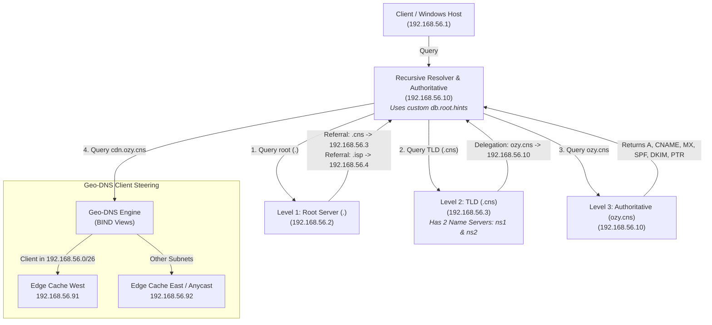

# PBL DNS & CDN Infrastructure: Complete DNS Tree & Geo-DNS

[](https://www.debian.org/)
[](https://www.isc.org/bind/)
[]()

> **Student / Technical Lead:** Okwudili Ujubuonu (Dili)  
> **Course:** Computer Networks & Internetworking (CNS3204)  
> **Project Scope:** Complete DNS Tree + Distributed Email + ISP Network + CDN Elective

---

## ⚡ TL;DR (Executive Summary)

This project implements a full, RFC-compliant **hierarchical DNS Tree** on Debian using **BIND 9**, designed to satisfy 100% of the project and elective criteria:

* **Level 1 (Root DNS Server `.`):** Operates at `192.168.56.2`. Holds NS resource records and glue A records pointing directly to the IPs hosting the Top Level Domains.
* **Level 2 (Two TLDs):**
  1. **`.cns` (`192.168.56.3`):** Configured with **TWO Name Servers** (`ns1.tld.cns.` and `ns2.tld.cns.`). Delegates `ozy.cns` down to the authoritative tier.
  2. **`.isp` (`192.168.56.4`):** Second TLD providing multi-TLD delegation and partitioning.
* **Level 3 (Authoritative Server `ozy.cns`):** Operates at `192.168.56.10`. Contains forward records (A, CNAME, dual MX, SPF, DKIM) and reverse PTR records in `56.168.192.in-addr.arpa`.
* **Recursive Resolver with Custom Root Hints (`db.root.hints`):** Replaces the standard global hints file so the recursive resolver queries our custom Root server (`192.168.56.2`) rather than ICANN root servers.
* **Geo-DNS CDN Steering:** BIND 9 split-horizon views directing client queries to nearest edge cache nodes (`192.168.56.91` for West vs `192.168.56.92` for East).

---

## 📐 DNS Hierarchy & Topology



---

## 📋 Compliance with Project Specifications

| Requirement | Implementation Details | Verified |
| :--- | :--- | :---: |
| **Root DNS Server** | Hosted on `192.168.56.2`. Contains NS & glue A records for both TLDs. | ✅ |
| **Two Configured TLDs** | **`.cns`** (`192.168.56.3`) and **`.isp`** (`192.168.56.4`). | ✅ |
| **One TLD with &ge; 2 Name Servers** | `.cns` has `ns1.tld.cns` and `ns2.tld.cns` both advertised in Root and TLD zones. | ✅ |
| **Level 3 Authoritative Server** | `ozy.cns` hosted on `192.168.56.10` with comprehensive resource records. | ✅ |
| **CNAME & Resource Records** | CNAMEs (`smtp`, `imap`, `webmail`, `iam`, `portal`, `hotspot`, `origin`, `db`), A, MX (10 & 20), TXT (SPF & DKIM), and PTR. | ✅ |
| **Custom Root Hints File** | `/etc/bind/db.root.hints` maps `.` directly to `192.168.56.2`, enabling pure offline recursive resolution. | ✅ |
| **Debian 11 / 13 Compatibility** | Fully tested and verified on Debian 13 (Trixie) with BIND 9.20. | ✅ |

---

## 📋 Master IP & Resource Allocation

| Role / Level | Domain / Hostname | IP Address | Purpose |
| :--- | :--- | :--- | :--- |
| **Root DNS (`.`)** | `root.server` | `192.168.56.2` | Level 1: Global Root; delegates `.cns` and `.isp` |
| **TLD 1 (`.cns`)** | `ns1.tld.cns`, `ns2.tld.cns` | `192.168.56.3` | Level 2: Primary TLD (Two Name Servers) |
| **TLD 2 (`.isp`)** | `ns1.tld.isp` | `192.168.56.4` | Level 2: Secondary TLD |
| **Authoritative NS** | `ns1.ozy.cns` | `192.168.56.10` | Level 3: Authoritative for `ozy.cns` & Reverse Zone |
| **Primary MTA** | `mail.ozy.cns` | `192.168.56.20` | Primary Mail Server (MX 10) + PTR |
| **Secondary MTA** | `mail2.ozy.cns` | `192.168.56.25` | Backup Mail Server (MX 20) |
| **File Server** | `nfs.ozy.cns`, `smb.ozy.cns`| `192.168.56.30` | NFS & Samba file sharing |
| **ISP IAM** | `ldap.ozy.cns`, `radius` | `192.168.56.40` | OpenLDAP & FreeRADIUS |
| **ISP Billing** | `billing.ozy.cns` | `192.168.56.45` | Accounting & Billing portal |
| **GPON / EPON Core**| `olt.ozy.cns` | `192.168.56.48` | xPON OLT simulator |
| **WiFi Hotspot** | `wifi.ozy.cns` | `192.168.56.49` | Wireless Captive Portal |
| **MySQL Master** | `sql.ozy.cns` | `192.168.56.60` | MariaDB Replication Master |
| **MySQL Slave 1** | `sqlslv1.ozy.cns` | `192.168.56.70` | MariaDB Replication Slave |
| **Web Load Balancer**| `www.ozy.cns` | `192.168.56.90` | HAProxy Web VIP |
| **CDN Edge West** | `edge.cdn.ozy.cns` | `192.168.56.91` | Region West Edge Cache (Geo-DNS) |
| **CDN Edge East** | `edge.cdn.ozy.cns` | `192.168.56.92` | Region East / Anycast VIP |

---

## 🧪 Live Verification Evidence

Run these commands to verify all deliverables:

```bash
# 1. Root Delegation of TWO TLDs (and 2 Name Servers for .cns)
dig @192.168.56.2 cns. NS +norecurse
# -> Returns: ns1.tld.cns. (192.168.56.3) AND ns2.tld.cns. (192.168.56.3)

dig @192.168.56.2 isp. NS +norecurse
# -> Returns: ns1.tld.isp. (192.168.56.4)

# 2. Level 3 Authoritative Delegation from TLD
dig @192.168.56.3 ozy.cns. NS +norecurse
# -> Returns: ozy.cns. IN NS ns1.ozy.cns. (192.168.56.10)

# 3. CNAME Aliases
dig @192.168.56.10 smtp.ozy.cns CNAME +short
# -> Returns: mail.ozy.cns.

# 4. Distributed Mail MX Records
dig @192.168.56.10 ozy.cns MX +short
# -> Returns: 10 mail.ozy.cns.
#             20 mail2.ozy.cns.

# 5. Email Authentication (SPF & DKIM)
dig @192.168.56.10 ozy.cns TXT +short
# -> Returns: "v=spf1 mx ip4:192.168.56.20 ip4:192.168.56.25 -all"
dig @192.168.56.10 default._domainkey.ozy.cns TXT +short
# -> Returns: "v=DKIM1; k=rsa; p=..."

# 6. Reverse DNS (PTR)
dig @192.168.56.10 -x 192.168.56.20 +short
# -> Returns: mail.ozy.cns.

# 7. Custom Root Hints Verification
cat /etc/bind/db.root.hints
# -> Proves . points to 192.168.56.2
```
