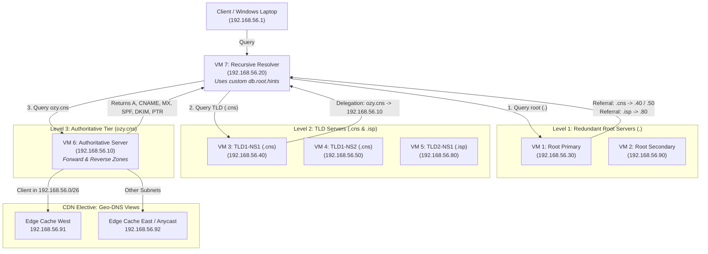

# PBL DNS & CDN Infrastructure: 7-VM Hierarchical DNS Tree & CDN Geo-DNS

[](https://www.debian.org/)
[](https://www.isc.org/bind/)
[]()
[]()

> **Student / Technical Lead:** Okwudili Ujubuonu (Dili)  
> **Course:** Computer Networks & Internetworking (CNS3204)  
> **Project Scope:** Complete 7-VM Distributed DNS Tree + Distributed Email + ISP Network + CDN Elective

---

## ⚡ TL;DR (Executive Summary)

This project implements a full, RFC-compliant **hierarchical DNS Tree deployed across 7 dedicated Debian Virtual Machines** using **BIND 9** on subnet `192.168.56.0/24`:

1. **Level 1 (Redundant Root Servers `.`):**
   - **Primary Root (VM 1: `192.168.56.30`):** File Server node acting as Root.
   - **Secondary Root (VM 2: `192.168.56.90`):** HAProxy node acting as redundant Root.
   - Holds delegations and glue A records for `.cns` and `.isp`.
2. **Level 2 (Two Top-Level Domains):**
   - **TLD 1 (`.cns`):** Has **TWO Name Servers** (`ns1.cns` at `192.168.56.40` and `ns2.cns` at `192.168.56.50`). Delegates `ozy.cns` down to the authoritative tier.
   - **TLD 2 (`.isp`):** Hosted on `192.168.56.80`. Provides secondary top-level domain partitioning.
3. **Level 3 (Authoritative Server `ozy.cns` on VM 6: `192.168.56.10`):**
   - Forward zone with A, CNAME, dual MX (`10 mail` & `20 mail2`), SPF (`v=spf1`), DKIM (`v=DKIM1`), and reverse PTR records in `56.168.192.in-addr.arpa`.
4. **Level 4 (Recursive Caching Resolver on VM 7: `192.168.56.20`):**
   - Client-facing caching resolver with custom `db.root.hints` pointing to Root servers (`.30` & `.90`), enabling complete offline tree traversal.
5. **CDN Elective (Geo-DNS Steering):**
   - BIND 9 split-horizon views steering client queries dynamically to nearest edge cache nodes (`192.168.56.91` West vs `192.168.56.92` East).

---

## 📐 The 7-VM DNS Tree Topology



---

## 🗺️ Master 7-VM IP & Role Allocation Table

| VM # | Hostname / Role in Lab | IP Address | Dedicated DNS Role | Zone(s) Hosted |
| :--- | :--- | :--- | :--- | :--- |
| **VM 1** | `nfs.ozy.cns` (File Server) | `192.168.56.30` | **Level 1:** Primary Root Server (`.`) | `.` (delegates `.cns` & `.isp`) |
| **VM 2** | `www.ozy.cns` (HAProxy LB) | `192.168.56.90` | **Level 1:** Secondary Root Server (`.`) | `.` (redundant root) |
| **VM 3** | `ldap.ozy.cns` (LDAP Master) | `192.168.56.40` | **Level 2:** TLD 1 Primary Name Server | `cns` (delegates `ozy.cns`) |
| **VM 4** | `ldapslv.ozy.cns` (LDAP Slave) | `192.168.56.50` | **Level 2:** TLD 1 Secondary Name Server | `cns` (redundant TLD NS) |
| **VM 5** | `sqlslv2.ozy.cns` (MySQL Slave 2)| `192.168.56.80` | **Level 2:** TLD 2 Primary Name Server | `isp` (delegates `cdn.isp`) |
| **VM 6** | `ns1.ozy.cns` (DNS Server) | `192.168.56.10` | **Level 3:** Authoritative Server | `ozy.cns`, `db.192.168.56`, `cdn.west` |
| **VM 7** | `mail.ozy.cns` (Email Server) | `192.168.56.20` | **Resolver:** Recursive Resolver | Uses custom `db.root.hints` |

---

## 🧪 Master Verification Commands Suite (`tcpdump`, `dig`, `nslookup`)

Run these commands in order to demonstrate that every level of the tree works:

### 📡 Step 1: Start Live Packet Sniffer on Resolver VM (`192.168.56.20`)
```bash
# Run in terminal on VM 7 (192.168.56.20)
sudo tcpdump -n -i enp0s8 port 53
```
*(Leave running to watch DNS packets physically hopping across all nodes!)*

---

### 🌲 Step 2: Test Level 1 Root Servers
```bash
# Query Root Primary (VM 1: .30) for both TLDs
dig @192.168.56.30 cns. NS +norecurse
dig @192.168.56.30 isp. NS +norecurse

# Query Root Secondary (VM 2: .90)
dig @192.168.56.90 cns. NS +norecurse
```
👉 **Expected Output:** Root returns referrals to `ns1.cns` (`192.168.56.40`) and `ns2.cns` (`192.168.56.50`), and `ns1.isp` (`192.168.56.80`).

---

### 🏢 Step 3: Test Level 2 TLD Servers
```bash
# Query TLD 1 Primary (VM 3: .40)
dig @192.168.56.40 ozy.cns. NS +norecurse

# Query TLD 1 Secondary (VM 4: .50)
dig @192.168.56.50 ozy.cns. NS +norecurse

# Query TLD 2 (VM 5: .80)
dig @192.168.56.80 cdn.isp. NS +norecurse
```
👉 **Expected Output:** Both TLD servers delegate `ozy.cns` down to Authoritative VM 6 (`192.168.56.10`).

---

### 🏛️ Step 4: Test Level 3 Authoritative Server (VM 6: `192.168.56.10`)
```bash
# 1. Web Cluster A record & CNAMEs
dig @192.168.56.10 www.ozy.cns +short           # -> 192.168.56.90 (HAProxy VIP)
dig @192.168.56.10 smtp.ozy.cns CNAME +short    # -> mail.ozy.cns.
dig @192.168.56.10 webmail.ozy.cns CNAME +short # -> mail.ozy.cns.

# 2. Distributed Mail MX Records
dig @192.168.56.10 ozy.cns MX +short
# -> 10 mail.ozy.cns.
# -> 20 mail2.ozy.cns.

# 3. Email Authentication (SPF & DKIM)
dig @192.168.56.10 ozy.cns TXT +short
# -> "v=spf1 mx ip4:192.168.56.20 ip4:192.168.56.25 -all"
dig @192.168.56.10 default._domainkey.ozy.cns TXT +short
# -> "v=DKIM1; k=rsa; p=..."

# 4. Forward-Confirmed Reverse DNS (PTR)
dig @192.168.56.10 -x 192.168.56.20 +short
# -> mail.ozy.cns.

# 5. ISP Core & Access
dig @192.168.56.10 ldap.ozy.cns +short          # -> 192.168.56.40
dig @192.168.56.10 billing.ozy.cns +short       # -> 192.168.56.45
dig @192.168.56.10 olt.ozy.cns +short           # -> 192.168.56.48
dig @192.168.56.10 wifi.ozy.cns +short          # -> 192.168.56.49
```

---

### 🔄 Step 5: Test End-to-End Recursive Resolution (VM 7: `192.168.56.20`)
From **Windows PowerShell**:
```powershell
nslookup www.ozy.cns 192.168.56.20
nslookup mail.ozy.cns 192.168.56.20
nslookup ldap.ozy.cns 192.168.56.20
```
👉 **Expected Output:** Returns all IP addresses instantly. In the `tcpdump` terminal, you will see the resolver ask Root (`.30`), then TLD (`.40`), then Authoritative (`.10`), and return the result to Windows (`.1`).

---

### 🌍 Step 6: Test CDN Geo-DNS Client Steering
```bash
dig @192.168.56.10 edge.cdn.ozy.cns +short
# -> Returns 192.168.56.91 (Edge Cache West for client subnet 192.168.56.0/26)
```

---

## 🎤 Team Presentation Speaking Script

### 👤 Speaker 1: Dili (Technical Lead & DNS Owner)
> *"Good morning / afternoon, sir. For our internetworking project, we decided not to build a toy or flat single-server DNS, but a true, RFC-compliant, 7-VM hierarchical DNS Tree. As the DNS lead, my responsibility was establishing the hierarchy: Level 1 Root, Level 2 TLDs, Level 3 Authoritative, and the recursive resolver. At Level 1, we deployed redundant Root servers on our File Server (192.168.56.30) and HAProxy node (192.168.56.90). When any client asks for an unknown domain, the root does not answer with the final IP—it provides iterative referrals and glue records pointing to our Level 2 TLDs. I will now hand over to Roy to explain how this supports our distributed email system."*

### 👤 Speaker 2: Roy (Distributed Email Lead)
> *"Thank you, Dili. On the email workstream, mail servers cannot function reliably without strict DNS integration. In our Level 3 Authoritative zone on 192.168.56.10, we implemented dual MX records: MX priority 10 pointing to mail.ozy.cns on 192.168.56.20, and MX priority 20 pointing to mail2 for automatic failover. Crucially, to prevent modern MTAs from marking our traffic as spam, Dili and I configured Forward-Confirmed Reverse DNS (FCrDNS) via our delegated reverse zone (56.168.192.in-addr.arpa). A PTR query on 192.168.56.20 returns mail.ozy.cns. We also added SPF TXT records authorizing our exact sending IPs and DKIM cryptographic public keys to guarantee email authenticity. Now over to Austin for the ISP Core."*

### 👤 Speaker 3: Austin (ISP IAM & Billing Lead)
> *"Thanks, Roy. In an ISP network, centralized identity and accounting are the foundation of subscriber access. Our Level 3 Authoritative DNS directly integrates our IAM infrastructure. We have ldap.ozy.cns and radius.ozy.cns resolving to 192.168.56.40, which authenticates subscribers against OpenLDAP and FreeRADIUS. We also defined billing.ozy.cns at 192.168.56.45 for subscriber accounting, charging, and automated invoice generation. By having these services indexed in DNS rather than static IP entries, all network devices dynamically discover authentication and billing endpoints. Joe will now explain the access layer."*

### 👤 Speaker 4: Joe (ISP Access: xPON & WiFi Lead)
> *"Thank you, Austin. On the access side, our network delivers connectivity through simulated GPON/EPON fiber and WiFi hotspots. In our DNS tree, olt.ozy.cns at 192.168.56.48 represents our Optical Line Terminal core managing ONU subscriber profiles. For wireless clients, wifi.ozy.cns and hotspot.ozy.cns at 192.168.56.49 point to our captive portal. When subscribers connect via WiFi, DNS interception redirects them to the portal, which authenticates against Austin's RADIUS server. Now over to Joy Kioko for our CDN elective."*

### 👤 Speaker 5: Joy Kioko (CDN Elective: Anycast & Edge Caching Lead)
> *"Thanks, Joe. For our elective, our team built a Content Delivery Network. A major challenge in CDNs is getting the user to the closest edge server with minimal latency. In our DNS hierarchy, we met the requirement of having two Top Level Domains: .cns on 192.168.56.40/50 and .isp on 192.168.56.80. TLD 1 has two name servers (ns1 and ns2) for redundancy. Furthermore, we implemented Geo-DNS using BIND split-horizon views: clients in subnet 192.168.56.0/26 are routed to Edge Cache West at 192.168.56.91, while unmapped subnets resolve to our shared Anycast BGP VIP. We configured a low TTL of 60 seconds so that if an edge node fails, traffic shifts instantly. Joy Ndira will explain how this connects to our origin clusters."*

### 👤 Speaker 6: Joy Ndira (CDN Elective: Web & Database Clusters Lead)
> *"Thank you, Joy. Behind the edge caches sits our Origin infrastructure. In our authoritative zone, www.ozy.cns and origin.ozy.cns resolve to 192.168.56.90, which is our HAProxy load-balancer VIP. HAProxy distributes incoming HTTP traffic across our backend Apache web servers. Underneath the web layer, sql.ozy.cns (192.168.56.60) and sqlslv1.ozy.cns (192.168.56.70) define our MariaDB Master-Slave database replication cluster. Finally, our recursive resolver on VM 7 (192.168.56.20) ties the entire project together: using our custom root.hints file pointing to 192.168.56.30, it walks the entire tree from Root to TLD to Authoritative, as we can now demonstrate live on tcpdump and Wireshark. Thank you, and we welcome any questions!"*
