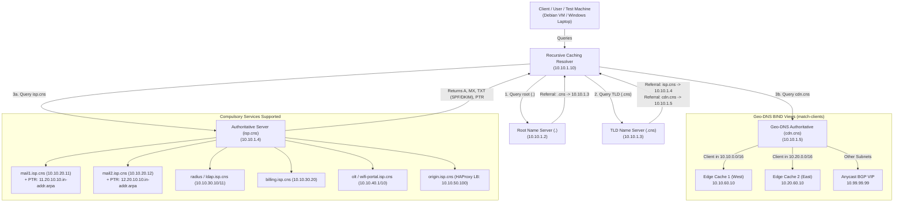

# PBL Internetworking Infrastructure: Complete DNS Tree & CDN Geo-DNS

[](https://www.debian.org/)
[](https://www.isc.org/bind/)
[]()

> **Project:** Computer Networks & Internetworking PBL  
> **Technical Lead & DNS/Geo-DNS Owner:** Okwudili Ujubuonu (Dili)  
> **Team Elective:** Content Delivery Network (CDN) + Distributed Email + ISP Network

---

## ⚡ TL;DR (Executive Summary)

* **What was built?** A complete, RFC-compliant **hierarchical DNS Tree** (`.` Root &rarr; `.cns` TLD &rarr; `isp.cns` Authoritative &rarr; `cdn.cns` Geo-DNS &rarr; Recursive Caching Resolver) deployed across Debian Virtual Machines using **BIND 9**.
* **What does it support?**
  1. **Distributed Email System (Roy):** Forward DNS, MX records, **PTR support (Reverse DNS)**, SPF, and DKIM verification records.
  2. **Complete ISP Network (Austin & Joe):** Centralized discovery for IAM (FreeRADIUS / OpenLDAP), Billing portal, GPON/EPON OLT management, and WiFi captive portals.
  3. **Content Delivery Network Elective (Joy Kioko & Joy Ndira):** **Geo-DNS using BIND 9 split-horizon views (`match-clients`)** to resolve client requests to their geometrically nearest Edge Cache node (`10.10.60.10` for Region West, `10.20.60.10` for Region East) and falling back to a shared Anycast BGP VIP (`10.99.99.99`) with low TTL (60s).
* **How to run tests?** On any Debian VM:
  ```bash
  chmod +x scripts/verify-dns.sh
  ./scripts/verify-dns.sh 10.10.1.10
  ```

---

## 📐 Architecture & DNS Tree Topology



---

## 🧠 Why Have We Chosen to Structure It This Way?

### 1. True RFC Iterative Tree vs. "Flat" Monolithic DNS
* **Real-World Internetworking Simulation:** Instead of hardcoding all records into a single zone file or `/etc/hosts`, building Root (`.`) &rarr; TLD (`.cns`) &rarr; Authoritative (`isp.cns`) proves understanding of **iterative referrals, glue records, and delegation chains** (RFC 1034/1035).
* **Decoupled Security (No Open Recursion on Authoritative Nodes):**
  * All authoritative nodes (`root`, `tld`, `auth`, `geodns`) have `recursion no;`. This prevents them from being abused in DNS amplification DDoS attacks and protects them from cache poisoning.
  * Only the dedicated **Recursive Resolver** accepts recursive queries (`recursion yes;`) from trusted internal subnets and handles client caching.

### 2. Forward-Confirmed Reverse DNS (FCrDNS) & Email Authentication
* **Spam Prevention & MTA Deliverability (Roy's Workstream):**
  * Standard Mail Transfer Agents (Postfix, Exim, Gmail, etc.) will drop or reject mail if the connecting IP does not have a matching `PTR` record that points back to the sending hostname.
  * We delegated `20.10.10.in-addr.arpa` to provide authoritative reverse lookup for `10.10.20.11` &rarr; `mail1.isp.cns.` and `10.10.20.12` &rarr; `mail2.isp.cns.`.
  * We embedded **SPF (`TXT "v=spf1 ..."`)** to authorize exact sending IPs and **DKIM (`TXT "v=DKIM1..."`)** to validate digital cryptographic signatures on outbound messages.

### 3. Split-Horizon Geo-DNS for the CDN Elective
* **Latency Reduction & Edge Offloading:**
  * In a Content Delivery Network, clients should fetch heavy media and web assets from the nearest edge cache rather than traversing the backhaul to the origin server.
  * By implementing BIND 9 **Views** with `match-clients`, DNS queries from `10.10.0.0/16` are steered directly to **Edge Node 1** (`10.10.60.10`), while queries from `10.20.0.0/16` are steered to **Edge Node 2** (`10.20.60.10`).
* **Low TTL (60 seconds) for Rapid Edge Failover:**
  * Traditional DNS uses 24-hour TTLs. For our CDN, we configure a 60-second TTL. If an edge node experiences an outage, DNS records update almost instantaneously.
* **Hybrid Anycast Routing Integration (Joy Kioko's BGP/FRR):**
  * Clients from non-specifically mapped subnets fall into the `default` view, returning the Anycast VIP (`10.99.99.99`). This allows BGP/FRR routing protocols at Layer 3 to select the best path, combining DNS-based steering with BGP Anycast resilience.

### 4. Shielding the Origin Web & Database Clusters (Joy Ndira)
* The origin web cluster (`origin.isp.cns` HAProxy) and MySQL clusters (`db-primary.isp.cns`, `db-replica.isp.cns`) are hosted strictly on the internal authoritative zone `isp.cns`. End users only access `cdn.cns` or `www.cdn.cns`, preserving origin server compute and preventing direct exposure to public attacks.

---

## 📋 Server Roles & Master IP Addressing Plan

| Tier / Role | Domain / Hostname | IP Address | Purpose / Workstream |
| :--- | :--- | :--- | :--- |
| **Root DNS** | `.` (`root-ns.root`) | `10.10.1.2` | Emulates global root; delegates `.cns` |
| **TLD DNS** | `.cns` (`tld-ns.cns`) | `10.10.1.3` | Authoritative for `.cns`; delegates `isp.cns` & `cdn.cns` |
| **Authoritative DNS** | `isp.cns` (`ns1.isp.cns`) | `10.10.1.4` | Authoritative for core ISP services & Reverse PTR |
| **Geo-DNS** | `cdn.cns` (`ns-geo.cdn.cns`) | `10.10.1.5` | View-based geo-routing to CDN edge caches |
| **Recursive Resolver**| `resolver.isp.cns` | `10.10.1.10` | Client-facing resolver with custom `root.hints` |
| **MTA Node 1** | `mail1.isp.cns` | `10.10.20.11` | Primary Mail Server (Distributed Email - Roy) |
| **MTA Node 2** | `mail2.isp.cns` | `10.10.20.12` | Backup Mail Server (Distributed Email - Roy) |
| **IAM (RADIUS/LDAP)** | `radius.isp.cns` | `10.10.30.10` | Authentication & User directory (Austin) |
| **ISP Billing** | `billing.isp.cns` | `10.10.30.20` | Accounting, charging, and invoices (Austin) |
| **xPON OLT Core** | `olt.isp.cns` | `10.10.40.1` | Optical Line Terminal simulation (Joe) |
| **WiFi Hotspot** | `wifi-portal.isp.cns` | `10.10.40.10` | Captive portal for wireless subscribers (Joe) |
| **CDN Edge 1 (West)** | `edge.cdn.cns` | `10.10.60.10` | Edge Cache for Region West / Nairobi (Joy Kioko) |
| **CDN Edge 2 (East)** | `edge.cdn.cns` | `10.20.60.10` | Edge Cache for Region East / Coast (Joy Kioko) |
| **CDN Anycast VIP** | `edge.cdn.cns` | `10.99.99.99` | Shared BGP Anycast VIP (Joy Kioko) |
| **Origin Web Cluster**| `origin.isp.cns` | `10.10.50.100`| HAProxy Web Server Load Balancer VIP (Joy Ndira)|
| **MySQL Master** | `db-primary.isp.cns` | `10.10.50.11` | Database Cluster Primary (Joy Ndira) |
| **MySQL Replica** | `db-replica.isp.cns` | `10.10.50.12` | Database Cluster Read Replica (Joy Ndira) |

---

## 🛠️ Debian VM Setup Instructions

### Option A: Standard Multi-VM Setup (Recommended)
Allocate your Debian VMs according to the IP plan above. For each VM:

1. **Install BIND 9:**
   ```bash
   sudo apt update
   sudo apt install -y bind9 bind9utils dnsutils
   ```
2. **Deploy the respective role:**
   - On the Root VM: copy `bind9/root/*` into `/etc/bind/`
   - On the TLD VM: copy `bind9/tld/*` into `/etc/bind/`
   - On the Authoritative VM: copy `bind9/authoritative/*` into `/etc/bind/`
   - On the Geo-DNS VM: copy `bind9/geodns/*` into `/etc/bind/`
   - On the Resolver VM: copy `bind9/resolver/*` into `/etc/bind/`
3. **Verify syntax & restart:**
   ```bash
   sudo named-checkconf /etc/bind/named.conf
   sudo systemctl restart named || sudo systemctl restart bind9
   sudo systemctl status named
   ```

*(Tip: You can use our automated script: `sudo ./scripts/deploy-debian.sh <role>`)*

### Option B: Consolidating on 2–3 Debian VMs (Resource-Constrained Laptops)
If your laptop cannot run 5 Debian VMs simultaneously:
* **VM 1:** Assign secondary IP aliases on your primary network interface (`eth0` or `ens33`):
  ```bash
  sudo ip addr add 10.10.1.2/24 dev eth0 label eth0:root
  sudo ip addr add 10.10.1.3/24 dev eth0 label eth0:tld
  sudo ip addr add 10.10.1.4/24 dev eth0 label eth0:auth
  sudo ip addr add 10.10.1.5/24 dev eth0 label eth0:geodns
  ```
* **VM 2:** Dedicated Recursive Resolver (`10.10.1.10`) pointing to `10.10.1.2`.
* **Alternative (Docker on Debian):** Run `docker compose -f docker/docker-compose.yml up -d` on a single Debian host. It starts all 5 nameservers on isolated IP addresses instantly!

---

## 🧪 Testing & Verification Guide

### 1. Automated Test Script
Run the built-in test suite from any Debian machine that has network connectivity:
```bash
chmod +x scripts/verify-dns.sh
./scripts/verify-dns.sh 10.10.1.10
```

### 2. Manual Verification Commands

* **Test DNS Tree Root Iteration:**
  ```bash
  # Query Root directly for referral to TLD
  dig @10.10.1.2 cns. NS +norecurse
  # Query TLD directly for referral to authoritative
  dig @10.10.1.3 isp.cns. NS +norecurse
  ```

* **Test Distributed Email (Roy's Deliverables):**
  ```bash
  # Check MX Records
  dig @10.10.1.10 isp.cns MX +short
  
  # Check Reverse DNS (PTR)
  dig @10.10.1.10 -x 10.10.20.11 +short
  # Result: mail1.isp.cns.

  # Check SPF & DKIM Records
  dig @10.10.1.10 isp.cns TXT +short
  dig @10.10.1.10 default._domainkey.isp.cns TXT +short
  ```

* **Test Geo-DNS Client Steering (CDN Elective):**
  ```bash
  # Simulate query from Region West (Subnet 10.10.0.0/16)
  dig @10.10.1.5 cdn.cns +subnet=10.10.10.50/24 +short
  # Returns: 10.10.60.10 (Edge 1 - West)

  # Simulate query from Region East (Subnet 10.20.0.0/16)
  dig @10.10.1.5 cdn.cns +subnet=10.20.10.50/24 +short
  # Returns: 10.20.60.10 (Edge 2 - East)

  # Simulate query from an unmapped external network
  dig @10.10.1.5 cdn.cns +subnet=172.16.5.10/24 +short
  # Returns: 10.99.99.99 (Anycast BGP VIP)
  ```

---

## 👥 Workstream Integration Matrix

| Team Member | Component | Integrated DNS Record |
| :--- | :--- | :--- |
| **Dili (Me)** | DNS Tree & Geo-DNS | Root (`.`), TLD (`.cns`), `ns1.isp.cns`, `ns-geo.cdn.cns`, `resolver` |
| **Roy** | Distributed Email | `mail1.isp.cns`, `mail2.isp.cns`, MX, SPF, DKIM, PTR `20.10.10.in-addr.arpa` |
| **Austin** | ISP IAM & Billing | `radius.isp.cns`, `ldap.isp.cns`, `billing.isp.cns` |
| **Joe** | ISP Access & WiFi | `olt.isp.cns`, `wifi-portal.isp.cns` |
| **Joy Kioko** | Anycast CDN Edge | `edge.cdn.cns` (Geo-DNS views + BGP Anycast VIP `10.99.99.99`) |
| **Joy Ndira** | Web LB & DB Cluster | `origin.isp.cns` (HAProxy VIP), `db-primary.isp.cns`, `db-replica.isp.cns` |

---

## 📜 Repository Structure

```
PBL-DNS-CDN-Infrastructure/
├── README.md                   # Comprehensive documentation & TL;DR
├── bind9/                      # Production BIND 9 configurations
│   ├── root/                   # Root server (.) config & db.root
│   ├── tld/                    # TLD server (.cns) config & db.cns
│   ├── authoritative/          # isp.cns forward zone & 10.10.20 reverse zone
│   ├── geodns/                 # View-based split-horizon CDN configs
│   └── resolver/               # Recursive caching resolver & custom root.hints
├── scripts/
│   ├── deploy-debian.sh        # Automated role deployment on Debian
│   └── verify-dns.sh           # End-to-end verification test suite
└── docker/
    └── docker-compose.yml      # Lightweight single-host simulation runner
```
